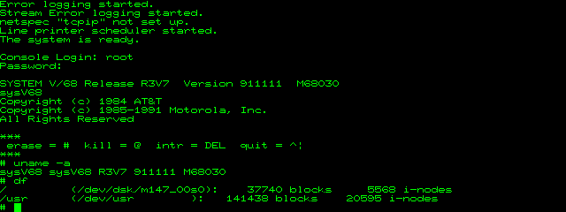

# Motorola MVME147 with System V/68 R3V7 in MAME

Changes to MAME that make its MVME147 board run the real 147Bug 2.44 monitor
and install and boot System V/68 Release R3V7, Motorola's Unix System V
Release 3 for the 68030 (kernel version 911111, November 1991), from its
original installation tape.

No Motorola or AT&T software is included here. The monitor comes from MAME's
`mvme147` ROM set and the system from the tape image in
<https://tenox.pdp-11.net/os/motorola/sysvr3v7.zip>; the scripts in this
repository do the rest.

## What works

- 147Bug 2.44: self tests, its command line, booting from SCSI tape and disk.
- The System V/68 installer, unattended, from the tape to a formatted disk:
  slices, file systems, all the packages and the root password.
- Booting the installed disk to multiuser and the console login, and a clean
  shutdown.

Not emulated: Ethernet, parity memory, the printer port. 147Bug reports
"Exception Processing test failed" because an access that should raise a bus
error does not; nothing else depends on it.

## What it took

The board driver is rewritten: PCC timers, interrupts and DMA, bus errors,
VMEchip and SCSI. On the way, 147Bug and System V/68 found problems in
MAME's 68882, WD33C93, SCSI tape and disk, and Z8530 emulation. All of it is
in [docs/HARDWARE.md](docs/HARDWARE.md).

## Layout

    patches/    changes to MAME: 68882, WD33C93, SCSI tape and disk, Z8530,
                the MVME147 driver, and an optional startup warnings fix
    harness/    build, unattended install, boot test, run, Windows build and pack
    tools/      SIMH tape image builder, s5 file system lister, COFF symbol lookup
    pack/       launchers and README of the Windows pack
    docs/       what was worked out

## Building

The patches are against MAME 60e07cb1 (2026-09-23), and the board runs in the
miniFORCE VME chassis.

    MAME_SRC=/path/to/mame harness/build.sh

That builds the `vme` subtarget. For Windows, see the top of
`harness/build-windows.sh` (MSYS2).

## Installing

Put MAME's `mvme147.zip` in `roms/`, unzip `sysvr3v7.zip` (it gives a
`42-00111` directory) and build `chdman` too (`TOOLS=1`). Then:

    MAME=/path/to/mame/vme harness/install.sh

It makes the tape image and a 316 MB disk in `work/`, boots the tape with
`bo 4,0` and answers the installer. It takes a few minutes. The root
password is `sysv68`.

    MAME=/path/to/mame/vme harness/boot-test.sh
    MAME=/path/to/mame/vme harness/run.sh

`boot-test.sh` boots a copy of the disk headless, logs in, runs `uname -a`
and shuts down. `run.sh` opens a MAME window with MAME's terminal as the
console, and types `bo 0,0` when 147Bug shows its prompt.

To shut the system down, as root:

    cd /
    /etc/shutdown -y -g0 -i0

and close the window after "System secured for powering down".

## Windows pack

With `vme.exe` from `build-windows.sh` and the installed disk compressed
(`chdman copy -i work/sysv68.chd -o sysv68-r3v7.chd`):

    harness\mkpack.ps1 -Vme vme.exe -Roms roms -Disk sysv68-r3v7.chd

makes a folder and a zip with the executable, the ROM, the disk and
[pack/README.txt](pack/README.txt), which explains how to use it and shut it
down. `harness\pack-test\pack-test.ps1 -Zip <zip>` unzips it and runs it
headless the way a user would.

## License

BSD-3-Clause, see [LICENSE](LICENSE), like the MAME files the patches change.
The MVME147 driver keeps the header of its original author, Joakim Larsson
Edström.
